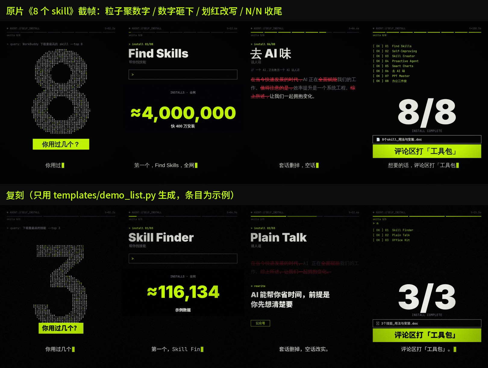
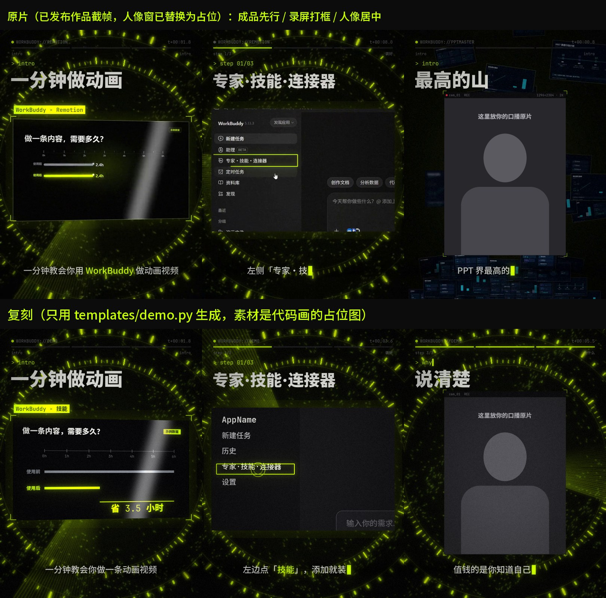
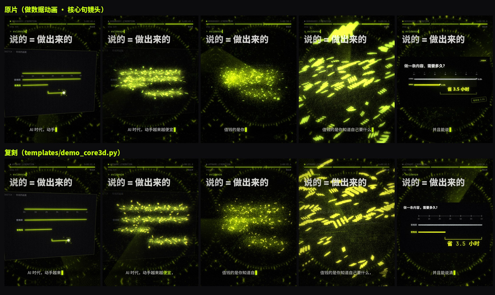
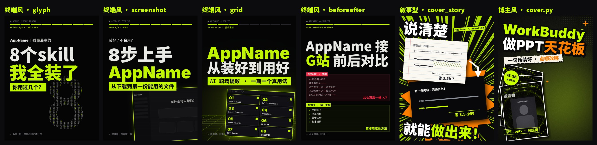

# 终端风视频风格包 · v1.0

我自己账号在用的视频风格，打包成了一个 agent skill：黑底，黄绿 #C8FF00 终端风，3:4 竖屏 4K。
装进 Claude Code、Codex、WorkBuddy 这些 agent，它就能照着参数和模板代码做出同样的画面。你不用跟它描述「要那种科技感」，配色、坐标、动效时长、混音参数都已经写死在里面。

v1.0 是重做的。我把自己用这套风格做过的每一期都过了一遍：分镜、渲染代码、成片、封面。全部收了进来，不按播放量挑。

## 一套皮肤，4 种结构
| 结构 | 适合 | 来自哪几期 |
|---|---|---|
| 清单体 | 盘点 N 个工具 / 技能 | 8 个 skill |
| 录屏教程 | 人不出镜，一步步带着操作 | 安装教程、做数据动画 |
| 口播教程 | 真人讲，配录屏和动效 | 接 G站、做 PPT |
| 观点讲解 | 讲一个方法，主角是一句提示词 | 提示词三维度（这期成片不在我手里，按分镜收的） |

另外两个模块，四种结构都能用：
- **核心句 3D 镜头**：草图碎掉，3D 穿越，再落位成成品。给一期里最重要的那句话用。
- **封面三类**：终端风（4 种主视觉）、博主风（描边大字 + 撕纸条 + 人像）、叙事型（草图 → 速度线里冲出成品）。

## 原片 vs 复刻
上排是我已发布作品的截帧（人像窗换成了占位图），下排是 skill 里的示范脚本生成的，素材也是占位图。

清单体

录屏教程
当前包未附此结构的对照图，详见 [录屏教程规范](references/preset-screen.md)。

口播教程

核心句 3D 镜头

封面

## 包里有什么（以下路径相对于本目录）
| 文件 | 用处 |
|---|---|
| `SKILL.md` | agent 的入口：先选结构，再读对应手册 |
| `references/style-guide.md` | 共用皮肤的全部参数，人也能直接看 |
| `references/preset-*.md` | 4 种结构各一份：结构、版式坐标、动作、节奏 |
| `references/module-core3d.md` | 核心句 3D 镜头 |
| `references/covers.md` | 三类封面 |
| `references/customize.md` | **怎么改成你自己的风格** |
| `references/workflow.md` | 从口播到成片的流程 + 交付检查清单 |
| `templates/` | Python 渲染代码：公共库、每种结构的原件库和示范、6 种动态背景、合成音效、混音、编码、三类封面，外加 OFL 开源字体 |
| `examples/` | 每种结构的示范样片、对照图、封面配置和总览 |
| `INSTALL.md` | 各个 agent 的安装方法 |

## 怎么用
1. 按 `INSTALL.md` 把 skill 装进你的 agent（需要 Python 3.10+ 和 ffmpeg）。
2. 先让它跑一遍你要用的那种结构的示范（`templates/demo_*.py`），出来的结果应该和 `examples/` 里的样片一样。跑通了，说明环境和字体都没问题。
3. 把你的口播、录屏、本期产出交给它，说「用 terminal-video-style 的录屏教程结构做这条视频，先出关键帧给我看」。
4. 流程按 `workflow.md` 走：语音识别拿逐字时间戳 → 剪口播 → 分镜 → 先出关键帧 → 渲染 → 音效混音 → 编码 → 过检查清单。

## 建议：照搬节奏，换掉皮肤
真正起作用的是节奏：一句话一个画面，3 秒必变，关键词出口那一帧有动作，顶栏进度一直挂着，念完就断。这些建议原样用。
颜色、顶栏名、背景、字体、封面配色最好换成你自己的，不然大家做出来一模一样，账号没有辨识度。改一行就能换色，具体改哪里见 `references/customize.md`。

## 已知限制
- 没带语音识别和剪口播的脚本。`workflow.md` 写了做法和推荐工具（sherpa-onnx SenseVoice），让 agent 现写就行。
- 观点讲解结构是按分镜做的，没对着成片逐帧核对。
- 4K 渲染吃 CPU：4 核大约每进程 3 秒一帧，核心句 3D 镜头更慢。可以先出 1080 预览，定稿后再出 4K。
- WorkBuddy 的导入入口没在所有版本上核对过。找不到入口的话，用 INSTALL.md 里的第 2 种方法。

用出问题，或者改出了更好的版本，欢迎在群里说。

## 授权
- 文档和代码：随便用、随便改，做出来的视频可以商用。转发 skill 包时请保留出处。
- 字体：全部是 SIL OFL 1.1 开源字体，见 `templates/fonts/FONTS.md`。
- 示例图里的界面截图来自我已发布的作品，只用来示意风格。

作者：Lxenry · 新岛AI自媒体实战营
